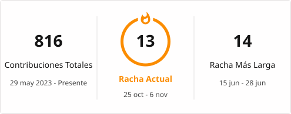

# 👋 Hola, soy Edward Antonio

---

## 👨‍💻 Sobre mí

🎓 Estudiante de **Ingeniería de Sistemas e Informática** en la **Universidad Tecnológica del Perú (UTP)**

💼 Enfocado en **Infraestructura TI, Cloud, automatización y soluciones tecnológicas**

🚀 Me interesa desarrollar soluciones que combinen **infraestructura, programación, datos e inteligencia artificial** para optimizar procesos y resolver problemas reales.

Actualmente continúo fortaleciendo mis conocimientos y experiencia en:

- 🖥️ **Infraestructura TI y administración de sistemas**
- ☁️ **Cloud Computing y virtualización**
- 🌐 **Redes y servicios tecnológicos**
- 🐧 **Linux y automatización de tareas**
- 📊 **Análisis e ingeniería de datos**
- ⚙️ **Automatización de procesos**
- 🧠 **Inteligencia Artificial aplicada**

---

## 🧰 Tech Stack

### 💻 Lenguajes

  

### ☁️ Cloud & DevOps

  

### 🗄️ Bases de datos

  

### 🖥️ Sistemas & Herramientas

  

---

## ⚡ Áreas de interés

`☁️ Cloud Computing`
&nbsp;&nbsp;
`🐧 Linux`
&nbsp;&nbsp;
`⚙️ Automation`
&nbsp;&nbsp;
`📊 Data Engineering`
&nbsp;&nbsp;
`🧠 Artificial Intelligence`

---

## 🧑‍💻 Badges

<table>
  <tr>
    <td align="center">
      
    </td>
    <td align="center">
      
    </td>
    <td align="center">
      
    </td>
    <td align="center">
      
    </td>
    <td align="center">
      
    </td>
  </tr>
  <tr>
    <td align="center">
      
    </td>
    <td align="center">
      
    </td>
    <td align="center">
      
    </td>
    <td align="center">
      
    </td>
    <td align="center">
      
    </td>
  </tr>
    </tr>
    <tr>
        <td align="center">
      
    </td>
    <td align="center">
      
    </td>
    <td align="center">
      
    </td>
    <td align="center">
      
    </td>
    <td align="center">
      
    </td>
  </tr>
    <tr>
  <td align="center">
      
    </td>
	<td align="center">
      
    </td>
  </tr>  
</table>

---

## 📢 Redes Sociales

## Actividad en GitHub

## 📊 GitHub Stats

  

---

  

---

    

---

  🧭 <em>"No hay viento favorable para quien no sabe a dónde va."</em> — Séneca

